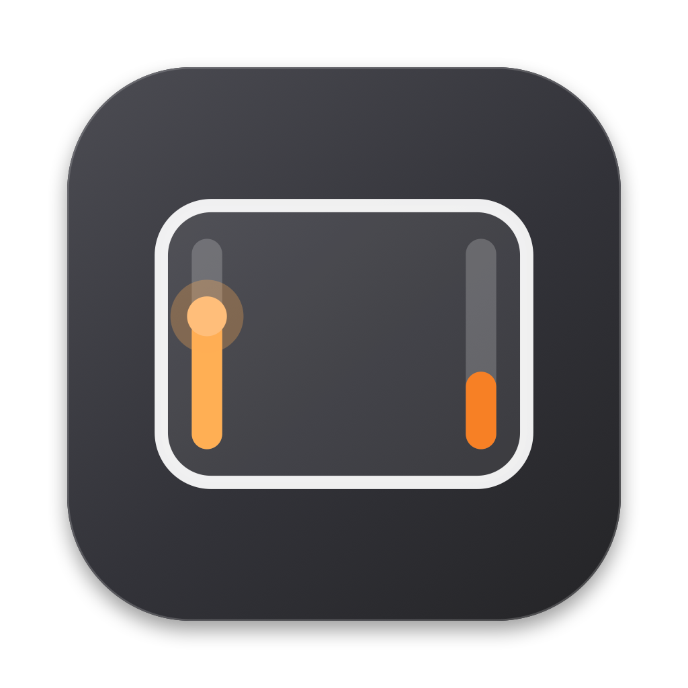
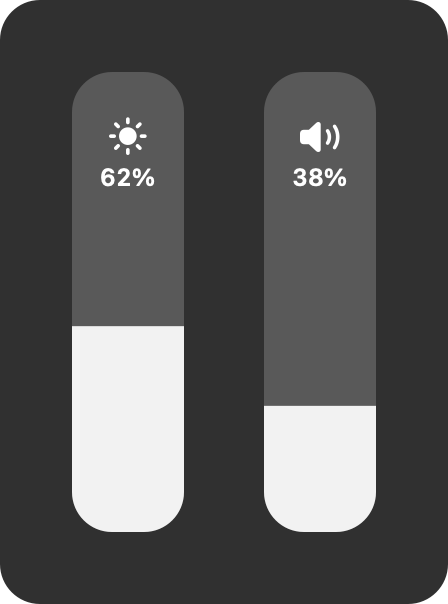
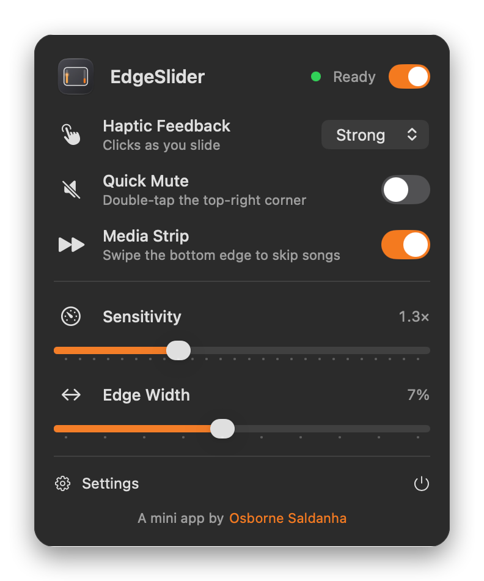
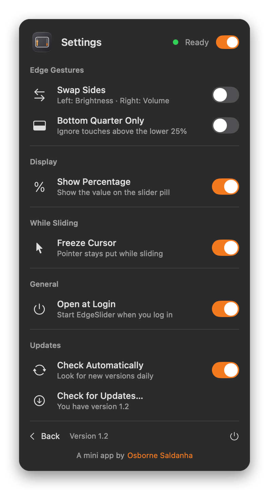

<p align="center">
  
</p>

<h1 align="center">EdgeSlider</h1>

<p align="center">
  Change your Mac's volume and brightness by sliding a finger along the edge of the trackpad.
</p>

<p align="center">
  <a href="https://github.com/os7borne/edgeslider/releases/latest"></a>
  <a href="LICENSE"></a>
  
  
</p>

<p align="center">
  <a href="https://edgeslider.osborne.vc"><b>Website</b></a> ·
  <a href="https://github.com/os7borne/edgeslider/releases/latest/download/EdgeSlider.zip"><b>Download</b></a> ·
  <a href="CHANGELOG.md">Changelog</a>
</p>

<p align="center">
  
  &nbsp;&nbsp;
  
</p>

EdgeSlider is a tiny menu bar app. Rest one finger on the **left edge** of your trackpad and slide up or down to change **brightness**. Do the same on the **right edge** for **volume**. A slim indicator slides in from the edge of the screen, the trackpad gives a small click at every step, and the pointer stays where it was.

It's free, open source, and signed and notarized by Apple.

## Install

1. [Download `EdgeSlider.zip`](https://github.com/os7borne/edgeslider/releases/latest/download/EdgeSlider.zip) and unzip it.
2. Drag **EdgeSlider** into your **Applications** folder and open it.
3. Look for the trackpad icon in the menu bar. Open it to change settings, and switch on **Open at Login** under Settings if you want it to start with your Mac.

Requires macOS 13 or later. It's a universal build, so it runs natively on Apple Silicon and Intel.

EdgeSlider keeps itself up to date: it checks for new versions daily and the menu bar icon turns orange when one is ready. You can also use **Settings → Check for Updates…**.

## Using it

| Gesture | What it does |
|---|---|
| Slide along the **left edge** | Brightness (built-in display) |
| Slide along the **right edge** | Volume |
| Swipe left or right along the **bottom edge** | Previous or next track |
| Double-tap the **top-right corner** | Mute (off by default, see below) |
| Double-tap the **top-left corner** | Switch the sound output to the next connected device (off by default, see below) |

A touch only counts if it **lands on the edge** and then moves, so a stray fingertip or a normal swipe across the pad does nothing. Sliding is relative to the current level, so nothing jumps when you touch down.

Everything is adjustable from the menu bar panel: haptic strength, sensitivity, how wide the edge zones are, swapping the two sides, limiting the sliders to the lower part of the pad, showing or hiding the percentage, freezing the pointer, and launch at login.

<p align="center">
  
</p>

## Good to know

- **Not on the Mac App Store.** To see your fingers on the trackpad edge, EdgeSlider uses Apple's **undocumented** multitouch and display interfaces (see [How it works](#how-it-works)). The App Store doesn't allow that, and a future macOS update could change those interfaces and break the app.
- **Brightness** changes the built-in display only. Volume follows whichever output you're using.
- **The media strip** sends the standard Next/Previous media keys, so it needs a player with a next track, such as a playlist or the Music or Spotify apps. A single YouTube video has nothing to skip to. macOS may ask for permission the first time the keys are sent.
- **Quick Mute and Switch Output are off by default.** Double-tapping a corner is a tap, and with *Tap to Click* turned on macOS also clicks wherever your pointer is. Turn it on in the panel if you use physical clicks. Tap about 1 cm in from the very tip of the corner: the sensor reads the extreme tip poorly.
- **No data collection.** There are no accounts and no analytics. The only network traffic is the update check to `edgeslider.osborne.vc`, and the download itself when you choose to install an update.

## How it works

- **Touch input:** `MultitouchSupport.framework` (private) delivers raw touch frames with normalized positions. A small state machine decides whether a touch landed on an edge and has moved past a dead zone before it engages.
- **Volume:** CoreAudio, setting the default output device's virtual main volume and mute.
- **Brightness:** `DisplayServices.framework` (private).
- **Pointer pinning:** the cursor is re-warped to its start position on every touch frame while you slide (`CGWarpMouseCursorPosition`), with no Accessibility permission needed.
- **Feedback:** `NSHapticFeedbackManager` for the clicks, and a borderless window for the indicator.
- **Media keys:** synthesized system-defined events.
- **Updates:** [Sparkle](https://sparkle-project.org). The feed is signed with an EdDSA key, and each release is also Developer ID signed and notarized.
- **UI:** SwiftUI in an `NSPopover`. No third-party code besides Sparkle.

Slider output is coalesced so only the newest value is ever applied, which keeps the sliders responsive even when a hardware call is slow.

## Build from source

You need macOS 13+ and the Xcode command line tools (`xcode-select --install`). It's built with a current Swift toolchain, and I haven't tested older ones.

```sh
git clone https://github.com/os7borne/edgeslider.git
cd edgeslider
./build.sh            # dev build: ./EdgeSlider.app, ad-hoc signed, runs on this Mac
open EdgeSlider.app
```

A dev build needs no certificate. `./build.sh install` also copies the app to `/Applications` (needed for a reliable *Open at Login*). The build downloads a pinned, checksum-verified copy of Sparkle into `vendor/` on first run.

```
Sources/EdgeSlider/   the app (main, Settings, SettingsView, Updater, Screenshots)
Assets/               app icon master (regenerated by build.sh)
scripts/              fetch-sparkle, make-appcast, make-icon, make-social, screenshots
site/                 the one-page website and the Sparkle appcast
notes/                per-version release notes, shown in the update window
docs/images/          README screenshots (generated, see below)
```

Regenerate the README screenshots from the real UI code with `scripts/screenshots.sh`.

### Making your own build or fork

`./build.sh release` produces a universal, Developer ID signed, notarized zip. It needs your own certificate and notarization key, set in a git-ignored `release.local.env` (`IDENTITY`, `KEY_PATH`, `KEY_ID`, `ISSUER`). If you fork and ship builds, change `BUNDLE_ID`, `FEED_URL` and `SPARKLE_PUBLIC_KEY` in `build.sh` so your copies don't talk to this project's update feed, and generate your own signing key with Sparkle's `generate_keys`.

## Contributing

Bug reports and pull requests are welcome. Please read [CONTRIBUTING.md](CONTRIBUTING.md) first. The most useful bug reports say which Mac and trackpad you have and which macOS version you're on.

## License

EdgeSlider is free software under the **GNU General Public License v3.0 or later**, see [LICENSE](LICENSE). It includes [Sparkle](https://github.com/sparkle-project/Sparkle) (MIT license) for updates.

---

A mini app by [Osborne Saldanha](https://osborne.vc).
